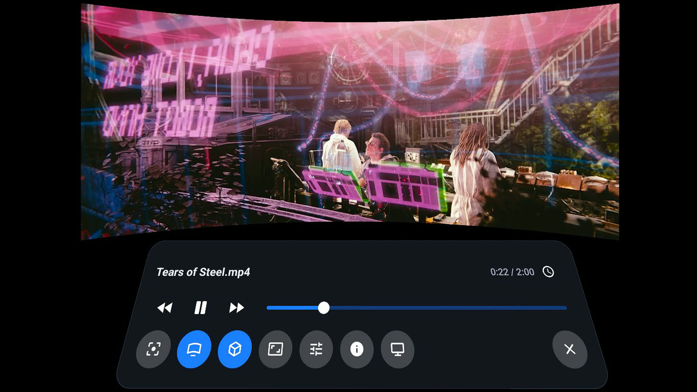
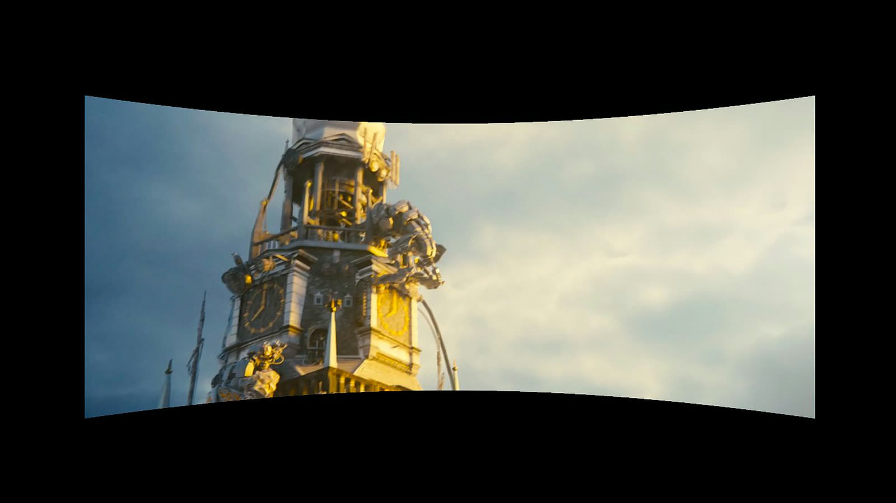
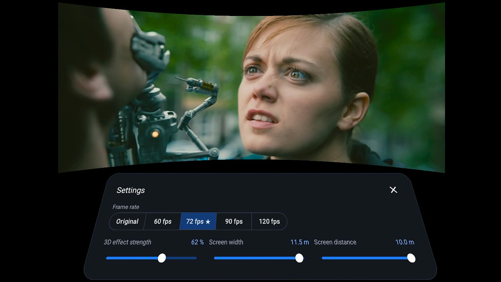
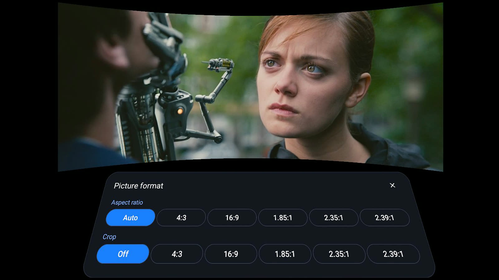
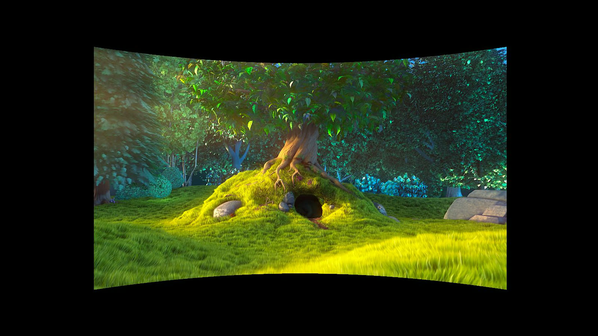

# Depth Player – AI 2D to 3D VR video player for Meta Quest

**Watch any video in 3D on Meta Quest 3.** Depth Player converts ordinary 2D movies, series and clips to stereoscopic 3D in real time, right on the headset, and makes motion smooth with frame interpolation. No PC, no streaming software, no cloud.

🌐 Website: https://alehano.github.io/depthplayer/ · 🔒 [Privacy policy](https://alehano.github.io/depthplayer/privacy.html) · 💬 [Support & FAQ](https://alehano.github.io/depthplayer/support.html)

## Screenshots

| | |
|---|---|
|  |  |
|  |  |

Screenshots show *Tears of Steel* and *Big Buck Bunny* (CC BY 3.0, Blender Foundation).

## Features

- **Real-time 2D → 3D conversion** – an on-device AI depth model gives every frame natural depth, rendered separately for each eye.
- **Stereoscopic 3D** – a separate view for each eye with adjustable depth, from any 2D video.
- **60 fps and higher** – motion-compensated frame interpolation (motion smoothing) plays 24/30 fps video at 60, 72, 90 or 120 fps, with scene-cut and fast-motion protection.
- **YouTube in VR, in 3D** – watch YouTube on a giant screen through the built-in browser, converted to 3D.
- **Virtual cinema** – flat or curved screen, adjustable size and distance, grab-to-move, recenter.
- **Sharper low-resolution video** – AMD FidelityFX Super Resolution (FSR) upscaling.
- **Plays from anywhere** – local files (MP4, MKV, MOV, WebM… via libVLC), DLNA/UPnP media servers (Plex, Jellyfin, Emby, NAS), SMB/SFTP/FTP/NFS shares, stream links and web video, including YouTube on the big screen in VR.
- **Everything a player needs** – subtitles and audio tracks, aspect ratio and crop, resume playback, VR and 2D window modes, 5 languages (English, Russian, Spanish, German, French).
- **Private by design** – no accounts, no ads, no analytics; all processing stays on the headset.

## Supported headsets

Meta Quest 3 and Quest 3S (recommended), Quest Pro, Quest 2.

## Feedback

Found a bug or have an idea? [Open an issue](https://github.com/alehano/depthplayer/issues) with your headset model and what you were playing.

---

*Keywords: 2D to 3D converter, 3D video player, VR video player, Meta Quest 3 video player, stereoscopic 3D, AI depth, frame interpolation, motion smoothing, 60 fps, 120 fps, virtual cinema, DLNA, SMB, Plex, Jellyfin, YouTube VR.*
